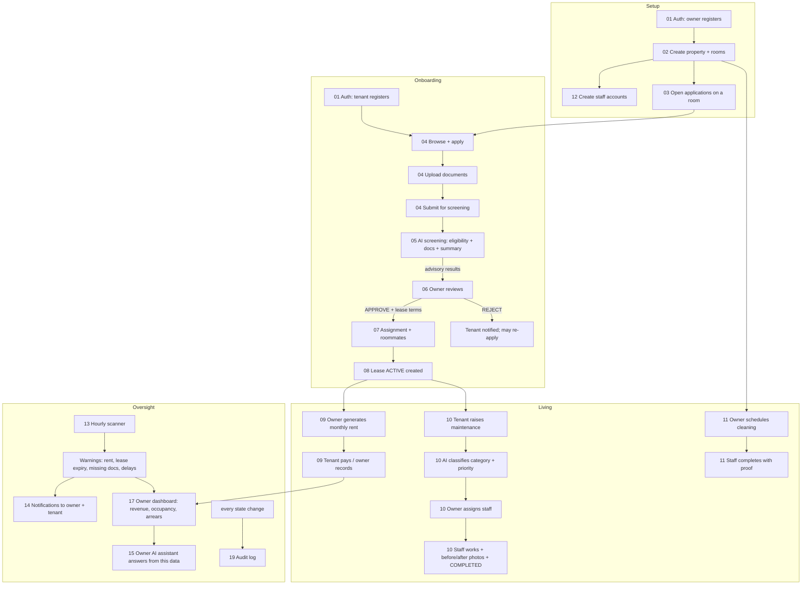

# 00 · End-to-end: the whole lifecycle

How the individual workflows chain together, from an empty system to a running tenancy
with rent, maintenance and warnings.



## The critical separation

Steps **05** (AI screening) and **06** (owner decision) are deliberately distinct:

| Step | Who | Output |
| --- | --- | --- |
| 05 | AI service | advisory score / recommendation / warnings — **changes nothing** |
| 06 | Owner (human) | `APPROVED` or `REJECTED` — the **only** decision point |

The AI never approves or rejects. See [16 · AI fallback](16-ai-fallback.md) for how
the advisory result is produced (NVIDIA NIM, or rule-based "Criteria Match %").

## Try it end-to-end

```bash
npm start          # MongoDB connection + backend + frontend + AI service
```

Then use real accounts:

1. Sign up as an **owner**, create a property and room, and open applications.
2. Sign up as a **tenant**, browse, apply, upload documents, and submit for screening.
3. As the owner, review the AI results and decide with lease terms.
4. As the tenant, view the lease and pay rent.
5. As the owner, create a staff account and assign a maintenance task.
6. As staff, progress and complete the assigned task.
